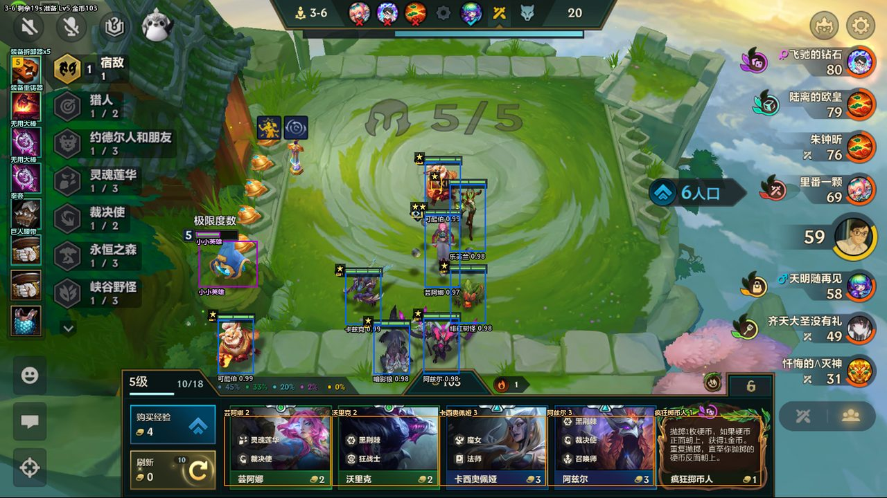
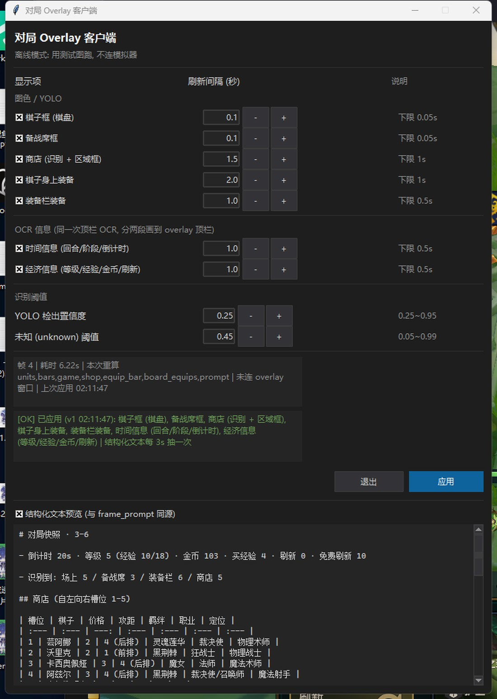

# jcc_robot_by_img

**纯图色的游戏视觉脚手架** —— 只靠截图，把游戏画面转成结构化文本，喂给 Agent 让它看得懂画面、能实时给你建议；需要动手时，也有一层带像素复核的点击 / 拖拽可用。


不读游戏内存、不注入、不改游戏文件。从一个完整的对局机器人里剥出来的图色部分，识别、抽取、操作、绘制各自独立，可以整层用，也可以只拿一个模块。

---

## 1. 干什么的

给你一套能跑的最小闭环，剩下的策略你自己写：

- **看懂画面**：一张 1920×1080 截图 → 棋子 / 血条 / 星级 / 装备 / 奖励球 / 阶段 / 商店 / 金币，结构化输出
- **点得准**：坐标换算 + 点击兜底 + 点后像素复核，不假设哪条输入通道一定生效
- **看得见**：把识别框实时画在游戏窗口上方的透明叠加层里，判错了一眼就能看出来；配套一个图形客户端，勾选框决定画哪几类、每类各用多长的刷新间隔
- **喂得动**：一帧画面直接组合成 Markdown 四表，能直接喂给 Agent

适合的场景是：**给 Agent 提供「游戏画面 → 结构化文本」的能力，让 Agent 陪你玩游戏时看得懂画面、能实时给出建议。**

---

## 2. 效果图



`scripts/overlay_info.py` 在真实对局帧上的输出：顶栏状态（回合 / 剩余时间 / 阶段 / 等级 / 金币）、棋子框 + 名字 + 置信度、**每根血条左侧星级徽记的金框**（2★/3★ 直接并在名字前显示成 2★ 芸阿娜，1★ 不显示）、小小英雄（绿框我方 / 红框敌方）、奖励球、商店卡、左侧装备栏。全部由识别结果实时绘制。

这张图在喂给 Agent 之前会先转成结构化文本。`scripts/frame_prompt.py` 一帧出六张表（下面是真实输出，每张表只留前 3 行示意，其余省略）：

```text
$ python -X utf8 -u -m scripts.frame_prompt --img tests/images/board_ingame.png

# 对局快照 · 3-6

- 倒计时 20s · 等级 5 (经验 10/18) · 金币 103 · 买经验 4 · 刷新 0 · 免费刷新 10
- 识别到: 场上 5 / 备战席 3 / 装备栏 6 / 商店 5

## 商店 (自左向右槽位 1-5)

| 槽位 | 棋子 | 价格 | 攻距 | 羁绊 | 职业 | 定位 |
| :--- | :--- | ---: | :--- | :--- | :--- | :--- |
| 1 | 芸阿娜 | 2 | 4 (后排) | 灵魂莲华 | 裁决使 | 物理术师 |
| 2 | 沃里克 | 2 | 1 (前排) | 黑荆棘 | 狂战士 | 物理战士 |
| 3 | 卡西奥佩娅 | 3 | 4 (后排) | 魔女 | 法师 | 魔法术师 |
| ... | | | | | | |

## 场上棋子 (格位 r1~r4 = 己方, -rN = 敌方)

| 格位 | 棋子 | 置信度 | 星级 | 羁绊 | 职业 | 定位 | 携带装备 |
| :--- | :--- | ---: | :---: | :--- | :--- | :--- | :--- |
| r1c4 | 可酷伯 | 0.99 | 1星 | 约德尔人和朋友 | 斗士 | 魔法坦克 | - |
| r2c4 | 乐芙兰 | 0.98 | 1星 | 永恒之森 | 法师 | 魔法术师 | - |
| r3c4 | 芸阿娜 | 0.97 | 2星 | 灵魂莲华 | 裁决使 | 物理术师 | - |
| ... | | | | | | | |

## 备战席棋子 (slot1~slot9)

| 槽位 | 棋子 | 置信度 | 星级 | 羁绊 | 职业 | 携带装备 |
| :--- | :--- | ---: | :---: | :--- | :--- | :--- |
| slot1 | 可酷伯 | 0.99 | 1星 | 约德尔人和朋友 | 斗士 | - |
| slot4 | 暗影狼 | 0.98 | 1星 | 峡谷野怪 | 狂战士 | - |
| slot5 | 阿兹尔 | 0.98 | 1星 | 黑荆棘 | 裁决使/召唤师 | - |

## 装备栏

| 槽位 | 装备 | 件数 | 类型 |
| :--- | :--- | ---: | :--- |
| 1 | 装备拆卸器 | 5 | 消耗品 |
| 2 | 装备重铸器 | 1 | 消耗品 |
| 3 | 无用大棒 | 1 | 散件 |
| ... | | | |

## 各玩家血量

| 玩家 | 血量 |
| :--- | ---: |
| 飞驰的钻石 | 80 |
| 陆离的欧皇 | 79 |
| 朱钟昕 | 76 |
| ... | |
```

只想要纯表格摘要的话，`scripts.extract_img_info --format table` 输出同样的信息，不含羁绊/职业这些联表补全的字段。

---

## 3. 怎么用

### 安装

Windows 10/11 + Python 3.11，游戏窗口需要 1920×1080。

```powershell
pip install -r requirements.txt

# 拉模型权重（21MB，走 Release 附件，自动校验 SHA256；国内可加 --proxy http://127.0.0.1:7890）
python -X utf8 -u -m tools.fetch_models

# 自检
python -X utf8 -u tools/selfcheck.py
```

### 离线试一下（不用打开游戏）

仓库带 5 张真实对局截图，所有能力都能直接跑：

```powershell
python -X utf8 -u -m scripts.overlay_info --img tests/images/board_ingame.png
# -> tempdir/overlay_info_board_ingame.png

python -X utf8 -u -m scripts.overlay_client --img tests/images/board_ingame.png
# -> 图形客户端，勾哪几项就画哪几项

python -X utf8 -u -m scripts.extract_img_info --img tests/images/board_ingame.png
python -X utf8 -u -m scripts.game units --img tests/images/board_ingame.png
python -X utf8 -u -m scripts.frame_prompt --img tests/images/board_ingame.png
```

### 图形客户端（深色，勾选显示项 + 逐项刷新间隔 + 结构化文本预览）



不想改 `config.py`、也不想记参数时用它：

```powershell
.\run_client.bat                                                 # 双击即可（启动器，改 PY 变量换解释器）
python -X utf8 -u -m scripts.overlay_client                      # 直接打开，自动找模拟器窗口
python -X utf8 -u -m scripts.overlay_client --ld-index 0         # 指定第 0 个模拟器
python -X utf8 -u -m scripts.overlay_client --img tests/images/board_ingame.png   # 离线，用测试图跑
```

不带参数时会自动探测雷电窗口；没探测到也照常打开界面（只打印 `[!] 没找到雷电模拟器窗口`，勾选与预览仍可用）。

**显示项（7 个，默认全勾）**

| 分组 | 选项 | 默认间隔 | 下限 | 说明 |
| --- | --- | --- | --- | --- |
| 图色 / YOLO | 棋子框（棋盘） | 0.1s | 0.05s | YOLO 棋子框 + 名字 + 星级 |
| 图色 / YOLO | 备战席框 | 0.1s | 0.05s | 备战席那 9 格 |
| 图色 / YOLO | 商店（识别 + 区域框） | 1.5s | 1.0s | 勾了就同时识别卡牌并画商店区域框 |
| 图色 / YOLO | 棋子身上装备 | 2.0s | 1.0s | 棋盘棋子携带的装备小图标 |
| 图色 / YOLO | 装备栏装备 | 1.0s | 0.5s | 左侧库存面板 |
| OCR 信息 | 时间信息（回合/阶段/倒计时） | 1.0s | 0.5s | 顶栏读 `3-6 准备 剩余20s`，画在 overlay 最上面 |
| OCR 信息 | 经济信息（等级/经验/金币/刷新） | 1.0s | 0.5s | `Lv5 经验10/18 金币103 免费刷新10 买经验4` |

两个 OCR 选项共用**同一次**顶栏 OCR（同一次截图只跑一遍数字识别），只是分别决定画哪一段。

**识别阈值**（也在界面上，不用改代码）

- `YOLO 检出置信度` 0.25 ~ 0.95（默认 0.25）：低于它的框直接丢弃。
- `未知 (unknown) 阈值` 0.05 ~ 0.99（默认 0.45）：低于它的框画成 `?`，高于它的才给名字。

**数值框旁边的 `-` / `+`**：每次 0.1（阈值行是 0.05），到上下限自动停，不会填出非法值。

**结构化文本预览**：勾选框和它的文本框是一个模块、紧挨着放在窗口下方，勾上就在正下方展开（再点收起）。
内容与 `python -m scripts.frame_prompt` 完全同源（`extract_info.prompt.to_markdown`），每 3 秒抽一次，深色等宽字体显示
`# 对局快照` + 商店 / 场上 / 备战席 / 装备栏 / 玩家血量几张表 —— 这就是能直接喂给 Agent 的那段文本。

**应用机制**

- 改完按右下角 **应用**（或回车），下一个绘制节拍（≤0.5s）就按新配置跑，**不重启进程、不改 config.py**；没按应用之前怎么改都不影响正在跑的循环。
- 间隔填得比下限小会被钳到下限并提示；填错（空、非数字、≤0）整次拒绝并红字说明，不会写一半。
- 全都不勾 = overlay 清空，但仍然保持对局检测；非对局画面（大厅/结算）自动暂停识别，不会画出一堆假框。
- 间隔是"请求间隔"：某一项真的算得比它慢时，实际刷新率就是这个项的识别耗时（YOLO 棋子 40ms 左右，OCR 约 1s），不会被强行拉到间隔值。

### 接真实游戏

```powershell
# 只观察：每秒一帧，打印 + 叠加绘制
python -X utf8 -u -m scripts.overlay_info --ld-index 0 --interval 1.0

# 动作命令先看计划，确认坐标对了再真点
python -X utf8 -u -m scripts.game buy --slot 1 --dry-run
python -X utf8 -u -m scripts.game buy --slot 1
```

### 在代码里直接用

```python
from capture.screen import capture_game, resize
from recognize import yolo_units, board, equipment, reward_ball, phase, hero

img     = resize(capture_game())               # PIL.Image, 1920x1080
units   = yolo_units.extract_units(img)        # 棋子
bars    = board.extract_units(img)             # 血条 + 星级 + 小小英雄
heroes  = hero.detect(img)                     # 小小英雄（等级块法）
slots   = equipment.extract_equipment(img)     # 左侧装备栏
balls   = reward_ball.find_balls(img)          # 奖励球
ph      = phase.detect(img)                    # 阶段
```

每个 CLI 都有 `--help`，参数不在这里堆。

---

## 4. 框架

```text
┌─────────────┐     ┌───────────────┐     ┌──────────────────┐
│ capture/    │────▶│ recognize/     │────▶│ extract_info/     │
│ 截图·找窗口  │     │ YOLO 模板 颜色 │     │ 一张图 → 结构化   │
└─────────────┘     │ OCR 阶段判定   │     └────────┬─────────┘
                    └───────┬───────┘              │
                            │                      ▼
                    ┌───────▼───────┐     ┌──────────────────┐
                    │ overlay/       │     │ control/          │
                    │ 透明叠加 + 绘制 │     │ 点击·拖拽·兜底·复核│
                    └───────────────┘     └──────────────────┘
```

```text
├── config/        配置 + 装备 id/名映射 + YOLO 类别信任表
├── capture/       截图 / 找雷电 RenderWindow
├── control/       后台点击·拖拽·按键·adb / fallback 通道兜底
├── recognize/     识别核心（yolo_units / board / equipment / reward_ball / phase / ocr / grid）+ 模板
├── extract_info/  一张图 → players / shop / game
├── overlay/       分层透明窗 + draw_frame 纯函数 + 节拍调度
├── scripts/       五个 CLI：extract_img_info / game / overlay_info / overlay_client / frame_prompt
├── units/         原画库 + 头像匹配 + 138 张模板
├── train_yolo/    类别冻结表
├── tools/         自检 / 四个自测 / 权重下载 / 诊断探针
├── scrape_info/   爬虫：抓赛季基础库（棋子/装备/羁绊/阵容 + 图标）
├── scrape_comp/   爬虫：抓单个阵容页 → 解密棋盘 → 打法文档
├── models/        ONNX 权重（不进 git，Release 附件）
├── workspace/     随仓库附带的赛季数据样本 + 运行时产物
└── tests/images/  5 张测试帧
```

---

## 5. 重点功能

**点击兜底**（`control/fallback.py`）
不假设某条通道一定生效：后台 `PostMessage` → 前台鼠标 → `adb tap`，每次点完都用像素差判断有没有生效，没生效就同通道重试、再换通道。拍不到 before 快照直接报错，绝不盲点。返回实际生效的通道和尝试次数。

**星级徽记定位**（`recognize/board.py`）
棋子血条左侧必定挂徽记（1★ 铜 / 2★ 银蓝 / 3★ 金），小小英雄挂等级数字。把这个当血条定位的正样本锚点：有 chevron 才是真棋子血条，有白数字才是小小英雄，两者都没有就是误检直接丢。非对局帧的假血条 25 → 0，真对局帧一根不少。

**小小英雄等级块法**（`recognize/hero.py`）
等级数字白块当锚点 → 右侧 +4…+22px 取色判绿（我方）/ 红（敌方）→ 16×22 模板余弦相似度读等级。8~19ms/帧，比原先的白名牌 OCR 召回高得多。

**格位口径只有一份**（`recognize/grid.py`）
我方 `r1~r4c1~c7`、备战席 `slot1~9`、敌方 `-r1~-r4`（负号只用于展示，不能点）。标签解析、标签→坐标、坐标→标签全在一个模块，`game.py` 和 `overlay_info.py` 都转发到这里。

**装备识别**（`recognize/equipment.py`）
官方图标库做模板匹配，覆盖左侧装备栏（5 格 × 10 行）和棋子身上携带的装备（血条下方 26px）。模板库缓存缺失时自动重建。

**奖励球**（`recognize/reward_ball.py`）
球恒 60×60 三色，HSV 就够。三道闸过滤界面高光（顶部 HUD / 人口按钮 / 英雄高光），误检 4 → 0。

**分项降频**（`overlay/live_draw.py`）
1 秒节拍下，棋子 / 血条 / 球每帧重算，OCR 类 3~5s 一次，装备栏 2s、携带装备 3s。热帧 0~0.5s。

---

## 已知限制

### 模型能力缺陷

> 目前这个图色识别方案，专注的是**准备阶段让 Agent 给建议**，所以训练数据目前只抓取了准备阶段的。

1. **棋子背面识别不了** —— 只支持准备阶段（棋子正面站立）的识别。战斗阶段棋子会转身背对屏幕，当前模型认不出来。
2. **高费棋子准确率下降** —— 4 费棋子准确率明显下滑，5 费基本识别不了，会标成 `unknown`，只能靠「点开棋子详情再读画面」的动态提取方案兜底。
3. **奖励球重叠/被遮时不稳** —— `yolo_balls` 在球互相重叠或被棋子挡住时会漏检，需要图色法（`recognize/reward_ball.py` 的 HSV 路径）这种召回率更高的方案来兜底。

### 其它

- `search-buy` / `start` / `exit` / `blessing` 未实现（纯图色口径需要连续状态机）
- 棋子身份以 YOLO 为准，模板血条的棋子名只做交叉校验
- 小小英雄遮挡严重时等级可能读成 `?`
- 真对局中的实时叠加效果尚未目视验证（离线落图和贴屏探针都已通过）

## 爬虫（可选）

```powershell
python -m scrape_info                # 抓赛季基础库 → workspace/scrape_info/v{版本}/
python -m scrape_comp 16278          # 抓单个阵容 → 解密棋盘 → 打法文档
```

只抓站点公开数据，不需要游戏在跑。仓库随附一份固定样本，clone 下来即可离线跑识别。详见 [scrape_comp/README.md](scrape_comp/README.md)。

## 想改哪里

| 目标 | 改这里 |
| --- | --- |
| 换游戏 / 换 UI 布局 | `recognize/regions.py` + `config/config.py` 坐标键 + `recognize/grid.py` |
| 换 / 重训模型 | `train_yolo/`（类别表）+ `models/` 换 onnx |
| 加识别项 | 照 `recognize/reward_ball.py`（HSV）或 `equipment.py`（模板库）写 `extract_xxx(img)`，到 `extract_info/extractor.py` 注册 |
| 加动作命令 | 照 `scripts/game.py` 的 `cmd_buy` 写 `cmd_xxx`，点击走 `click_with_fallback` |
| 接自己的决策 | `overlay_info --json` 或 `extract_info.extract(img)` 拿结构化帧，再用 `scripts.game` 执行 |
| 改血条 / 英雄识别 | 先读 [docs/血条与hero识别.md](docs/血条与hero识别.md)（七层判定链、常量、重标定步骤），数值明细见 [docs/图色口径.md](docs/图色口径.md) |
| 优化速度 / 上并行 | [docs/性能与并行方案.md](docs/性能与并行方案.md)：各识别项实测基准、分档合计、与父项目同机对比、两路并行架构与三阶段预期 |